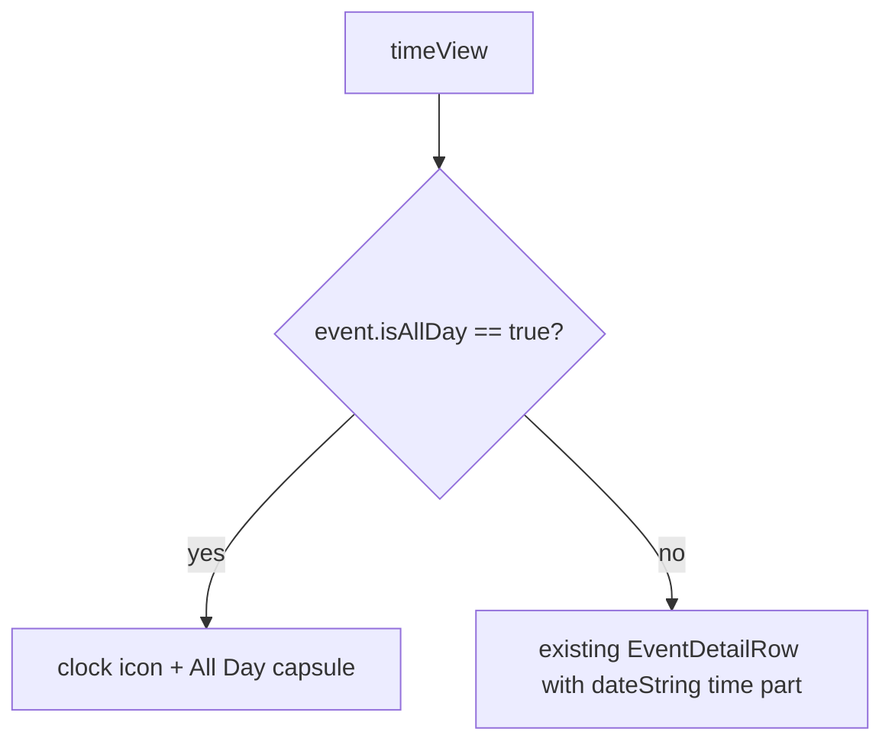

# Technical Specification: ASDLC-572 - All Day Capsule on Event Detail Time Row

**Status:** Draft
**Author:** Tech Lead Agent
**Created:** 2026-11-17

---

## 🎯 Problem

**Current state** (verified in code):
- `berkeley-mobile/Events/EventDetailView.swift` → `BMDetailHeaderView.timeView` renders `EventDetailRow(systemImageName: "clock", text: <last segment of event.dateString split by " / ">)`.
- `event.dateString` comes from the `BMCalendarEvent` extension (`berkeley-mobile/Data/ItemProtocols/BMCalendarEvent.swift`). It only emits "All Day" when start is exactly 00:00:00 **and** end is exactly 11:59:59; otherwise it prints `h:mm a`, so flagged all-day events with other times (or no end) show e.g. "12:00 AM". It ignores `isAllDay`.
- `BMEventCalendarEntry.isAllDay: Bool?` (`Events/EventDataSource/BMEventCalendarEntry.swift`) is already populated by `EventsViewModel` (`isAllDay: $0.isAllDay`) and already drives `AllDayEventBannerView` in `EventsView` (`event.isAllDay == true`).
- `dateString` is shared by other `BMCalendarEvent` conformers (e.g. gym classes, `OpenTimesCardView`/calendar-add flows) — changing it would affect other screens (out of scope, BR-006).
- Existing component check: `AllDayEventBannerView` is a full-width banner bound to the event name (not reusable as an inline badge). `EventDetailRow` is icon+text only. No existing pill component; a small private capsule is needed.
- DI: no new classes/services; no Factory registration needed. DTO nullability: `isAllDay` is an optional Bool → treat `nil` as false (BR-002). Transformation ownership: upstream supplies the flag; client passes it through, no inference.
- No test target exists (`docs/testing-standards.md`).

**Desired state:** when `event.isAllDay == true`, the time row shows the clock icon plus an "All Day" capsule and no time; otherwise unchanged.

**Impact:** accurate display for all-day events; purely presentational.

---

## 📋 Architectural Decisions

### Decision 1: Where to branch on All Day

| Option | Pros | Cons | Effort |
|---|---|---|---|
| A. Branch in `BMDetailHeaderView.timeView` using `event.isAllDay == true` (**chosen**) | Minimal, single file, flag is the source of truth (BR-002), no impact on other screens | Detail view and `dateString` heuristic may disagree elsewhere (accepted, out of scope) | XS |
| B. Change `BMCalendarEvent.dateString` to honor the flag | Fixes every consumer | Protocol extension has no `isAllDay`; returns a String so no capsule; affects gyms/calendar flows (violates BR-006 spirit) | M |
| C. Infer all-day from start/end times in the view | No reliance on flag | Re-implements upstream logic; contradicts BR-002 | S |

**Decision:** Option A. Rationale: upstream already supplies the flag (pass-through, no re-implementation); follows existing `EventsView` usage `event.isAllDay == true`.

### Decision 2: Capsule component
- A: reuse `AllDayEventBannerView` — rejected (full width, shows event name).
- B: new private `AllDayCapsuleView` in `EventDetailView.swift` styled like the banner (`Capsule().fill(.gray.opacity(0.5))`, `BMFont.bold`) (**chosen**). Uses `Text` background rather than fixed frame height so Dynamic Type grows it (NFR).

### Decision Flow


Standards: `docs/code-conventions.md`/`docs/structure.md` — SwiftUI views live in `berkeley-mobile/Events/`; project uses `BMFont`/`BMColor` helpers.

---

## 🏗️ Architecture and Implementation

### Architecture
SwiftUI-only presentational change. Data flow: Firestore → `EventsViewModel` (maps `isAllDay`) → `BMEventCalendarEntry` → `EventDetailView` → `BMDetailHeaderView.timeView`. No model, networking, or DI changes.

### Implementation Plan
1. Edit `berkeley-mobile/Events/EventDetailView.swift`:
   - Replace `timeView` with an `isAllDay` branch.
   - Add `AllDayCapsuleView` (private struct) in the same file.
2. Add an All Day sample to previews (`#Preview`) using `BMEventCalendarEntry(name:date:isAllDay: true)` for visual checks in light/dark.
3. Do not touch `BMCalendarEvent.dateString`, `EventDetailRow`, `AllDayEventBannerView`, date/location rows.

### Code Template
```swift
@ViewBuilder
private var timeView: some View {
    if event.isAllDay == true {
        HStack {
            Image(systemName: "clock")
                .font(.system(size: 16))
            AllDayCapsuleView()
        }
    } else if let timePart = event.dateString.components(separatedBy: " / ").last {
        EventDetailRow(systemImageName: "clock", text: timePart)
    }
}

private struct AllDayCapsuleView: View {
    var body: some View {
        Text("All Day")
            .font(Font(BMFont.bold(12)))
            .foregroundStyle(.primary)          // legible in light & dark
            .padding(.horizontal, 10)
            .padding(.vertical, 3)
            .background(Capsule().fill(.gray.opacity(0.5)))
            .accessibilityLabel("All Day")
    }
}
```
Note: the HStack mirrors `EventDetailRow` layout so the icon alignment matches (BR-004). Verify contrast of `.primary` on `gray.opacity(0.5)` over `.regularMaterial` in both appearances; adjust fill opacity if needed.

---

## ✅ Testing, Security, and Definition of Done

### Testing Strategy
Per `docs/testing-standards.md` there is no test target and no XCTest usage; adding one is out of scope. Verification:
- SwiftUI previews: all-day (flag true, start 12:00 AM), timed with end, timed without end, `isAllDay == nil`; light + dark; largest Dynamic Type.
- Manual checks mapping to the Gherkin scenarios in `business-requirements.md` (capsule shown, no "12:00 AM"; timed unchanged; date/location rows unchanged; VoiceOver reads "All Day").
- Regression: Events list banner unchanged.

### Security Considerations
- [x] No new input, network, or storage; no secrets; no PII; no logging added.

### Definition of Done
- [ ] `timeView` branches on `isAllDay == true`; `nil` treated as timed.
- [ ] Capsule reads exactly "All Day", with clock icon retained.
- [ ] Legible in light/dark; scales with Dynamic Type; VoiceOver announces "All Day".
- [ ] Timed event display byte-identical to before; other rows/screens untouched.
- [ ] App builds with no new warnings; previews updated.
- [ ] Meets `docs/dod.md`.

### Out of Scope
Events list banner redesign; `dateString` formatting/heuristic changes; data-source flag changes; calendar export; other screens; localization; adding a test target.

### References
- `docs/tech.md`, `docs/structure.md`, `docs/code-conventions.md`, `docs/testing-standards.md`, `docs/dod.md`
- `specs/ASDLC-572/business-requirements.md`, `specs/ASDLC-572/prototype/`
- Code: `Events/EventDetailView.swift`, `Events/EventsView.swift`, `Events/AllDayEventBannerView.swift`, `Events/EventDataSource/*`, `Data/ItemProtocols/BMCalendarEvent.swift`
