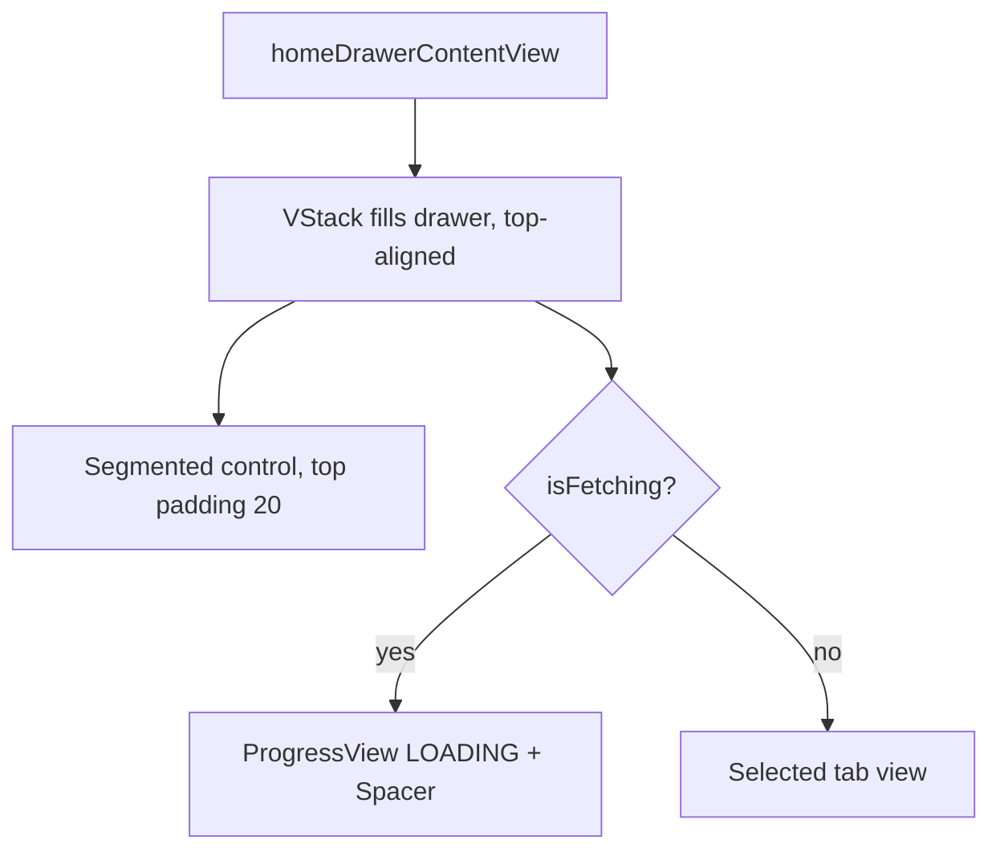

# Technical Specification: ASDLC-573 - Home drawer content centered while loading

**Status:** Draft
**Author:** Tech Lead Agent
**Created:** 2026-11-18

---

## 🎯 Problem

**Context.** `berkeley-mobile/Home/HomeView.swift` renders the Home drawer via `BMDrawerView` (`berkeley-mobile/Common/BMDrawerView.swift`) wrapping `homeDrawerContentView`: a `NavigationStack` whose root is a `VStack(alignment: .leading)` containing `segmentedControlHeader` (`BMSegmentedControlView`, `.padding(.top, 20)`) followed by either `ProgressView("LOADING")` + `Spacer()` (when `homeViewModel.isFetching`) or the selected tab's view.

**Current state.** `BMDrawerView` places content in a `ZStack` sized to the drawer (`.frame(width:height:alignment: .top)`), but the content VStack itself has no max-size frame. The ZStack centers its children, and the NavigationStack root VStack is only as tall as its content (the `Spacer()` has nothing to expand into unless the container proposes full height). Result: during loading, the short content (segmented control + spinner) is vertically centered. Once loaded, the tab views (lists) are greedy and fill the height, so the header sits at the top → visible jump.

**Desired state.** Header and loading indicator are top-aligned during loading at the same offset as in the loaded state (BR-001..BR-004); loaded behavior unchanged (BR-005). No backend/data change.

**Exploration checklist.**
- Existing components: reuse `BMSegmentedControlView`, `ProgressView("LOADING")`; no new component.
- DI wiring: none; no new classes (`HomeViewModel` already injected via `@InjectedObject`).
- DTO nullability / transformation ownership: not applicable (pure layout change).
- Similar sibling: `GuidesView` (`Home/Guides/GuidesView.swift`) uses `VStack { ProgressView(); Spacer() }` and relies on the same parent height; it is fixed transitively by the parent frame.
- Design reference: `specs/ASDLC-573/prototype/` (before/after).

---

## 📋 Architectural Decisions

## 📋 Architectural Decisions

**Decision 1: Where to enforce top alignment**

| Option | Description | Pros | Cons | Effort |
|---|---|---|---|---|
| A (chosen) | Add `.frame(maxWidth: .infinity, maxHeight: .infinity, alignment: .top)` to the root `VStack` in `homeDrawerContentView` | One-line, local to Home; existing `Spacer()`s then work; fixes loading, empty and Guides states; same offset as loaded state | None significant | XS |
| B | Change `BMDrawerView` ZStack alignment to `.top` | Fixes at the shared component | `BMDrawerView` is shared (Safety etc.); risks regressions outside scope (spec says no other screens) | S |
| C | Replace spinner branch with a separate top-pinned layout | Explicit | Duplicates header, risk of offset mismatch (violates BR-002) | S |

**Decision:** Option A. Keeps the single shared header in the same view hierarchy for both states, guaranteeing BR-002/BR-003 (no jump). Trade-off: relies on the Home view applying the frame itself rather than fixing the shared drawer. Aligned with `docs/code-conventions.md` (SwiftUI feature-local views; no changes to shared components) and `docs/structure.md`.

Also: keep the `.frame` on the VStack (inside the NavigationStack), not on the NavigationStack, so navigation detail pushes are unaffected.

## 🔄 Decision Flow



---

## 🏗️ Architecture and Implementation

## 🏗️ Architecture

Pattern: SwiftUI layout fix, no new components. Data flow unchanged: `HomeViewModel.isFetching` → `HomeView.homeDrawerContentView` branch. Only the container's size proposal/alignment changes.

## 💻 Implementation Plan

1. Edit `berkeley-mobile/Home/HomeView.swift`, in `homeDrawerContentView`, apply the frame modifier to the root `VStack(alignment: .leading)`, before `.navigationBarTitleDisplayMode`:

```swift
VStack(alignment: .leading) {
    segmentedControlHeader
    if homeViewModel.isFetching {
        ProgressView("LOADING")
            .padding(.vertical, 20)
            .frame(maxWidth: .infinity)
        Spacer()
    } else { /* unchanged */ }
}
.frame(maxWidth: .infinity, maxHeight: .infinity, alignment: .top)
.navigationBarTitleDisplayMode(.inline)
```

2. Do not modify `BMDrawerView`, `HomeViewModel`, or the tab views. Keep `.padding(.top, 20)` on the header unchanged (identical offset in both states).
3. If manual QA shows the loaded lists shift, verify `DiningHallsView`/`FitnessView`/`LibrariesView` are already height-greedy (they should be; frame is a no-op for them).

---

## ✅ Testing, Security, and Definition of Done

## ✅ Testing Strategy

Per `docs/testing-standards.md`, the repo has no test targets or conventions, so no automated tests are added (introducing a test target is out of scope for an XS layout fix). Verification is manual:
- Launch with throttled network/slow fetch; confirm header + "LOADING" at top at medium (.45) and large detents, light/dark, small and large iPhone, large Dynamic Type.
- Confirm no vertical movement of the segmented control when loading ends.
- Switch Dining/Fitness/Study/Guides; confirm unchanged. Trigger refetch; confirm top alignment again.
- Add an Xcode `#Preview` is optional; existing `#Preview` remains.

## 🔒 Security Considerations
- [x] No input handling, auth, networking, or data storage changes.
- [x] No secrets or new dependencies.

## ✅ Definition of Done
- [ ] `.frame(... alignment: .top)` added in `HomeView.swift` only
- [ ] Project builds with no new warnings
- [ ] Manual QA scenarios above pass on small and large iPhone
- [ ] No changes to `BMDrawerView` or other screens
- [ ] PR references ASDLC-573

## 🚫 Out of Scope
- Redesigning loader/segmented control, skeletons, new loading states
- Data fetching/caching changes; drawer gestures/detents
- Fixing `BMDrawerView` centering for other screens; adding a test target

## 📚 References
- `docs/structure.md`, `docs/code-conventions.md`, `docs/testing-standards.md`, `docs/tech.md`
- `specs/ASDLC-573/business-requirements.md`, `specs/ASDLC-573/prototype/`
- Code: `berkeley-mobile/Home/HomeView.swift`, `berkeley-mobile/Common/BMDrawerView.swift`, `berkeley-mobile/Home/Guides/GuidesView.swift`
