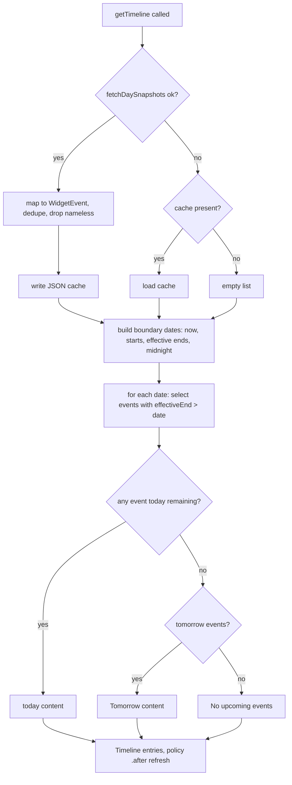
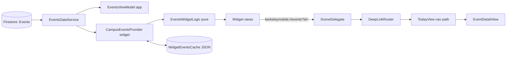

# Technical Specification: ASDLC-574 - Campus Events Home Screen Widget

**Status:** Draft
**Author:** Tech Lead Agent
**Created:** 2026-11-18

---

## 🎯 Problem

### Context
Campus events are only visible in-app via `EventsView` (`berkeley-mobile/Events/EventsView.swift`), reached from the calendar `NavigationLink` in `TodayView`. Business rules BR-001..BR-014 and acceptance scenarios are in `specs/ASDLC-574/business-requirements.md`. The only existing widget is `GymOccupancyWidget` (`BerkeleyMobileWidget/`), registered in `BerkeleyMobileWidgetBundle`.

### Current state (verified in code)
- `berkeley-mobile/Events/EventDataSource/EventsViewModel.swift` holds in ONE file: `BerkeleyEventsDaySnapshot`, `BerkeleyEvent`, `EventsDataService` (Firestore collection `"Events"`, `getDocuments()`, `doc.data(as:)`, errors logged via `Logger.eventsDataService`) and the `@MainActor @Observable EventsViewModel`. The file imports `FirebaseAnalytics`, `SwiftUI`, and uses `UIApplication`, `BMEventManager` (EventKit), `BMAlert`. It cannot be compiled by the widget as-is.
- `EventsDataService.fetchEventsGroupedByDate()` returns `[(Date, [BMEventCalendarEntry])]`. `BMEventCalendarEntry` (`NSObject`, `UIKit`, `@Display` wrappers, `HasImage`, `CanFavorite`) is UIKit-bound → not suitable for the widget. The mapping applies: `name = eventName ?? ""`, `date = startTime ?? Date().getStartOfDay()` (note: app uses *today*, BR-007 requires the *snapshot day*), `isAllDay` passthrough.
- DTO nullability: `BerkeleyEventsDaySnapshot.date`, `displayDate`, `scrapedAt` optional; `events` non-optional. Every `BerkeleyEvent` field is optional (`startTime, endTime, eventName, eventDescription, eventRegisterLinkURL, eventImageURL, eventURL, isAllDay, location`). The service skips snapshots with nil `date` and swallows fetch errors (returns `[]`) — the widget therefore cannot distinguish "offline" from "no events" using this API.
- `Logger.eventsDataService` is declared in `Utils/Logger+Ext.swift`, which also references app-only types (`DiningHallsViewModel`, …) so the whole file cannot be shared with the widget.
- Widget target `BerkeleyMobileWidgetExtension` uses a `PBXFileSystemSynchronizedRootGroup` for its own folder (only `Info.plist` excluded) and explicit "Sources" membership for shared app files (`GymOccupancyViewModel.swift`, `TimeInterval+Ext.swift`, `Fonts.swift`). Firebase is configured in `BerkeleyMobileWidgetBundle.init()`; Pod: Firebase/Firestore. Widget deployment target 17.0+ (docs/tech.md).
- DI: `Container.eventsViewModel` in `berkeley-mobile/BerkeleyMobile+Injection.swift` (FactoryKit). `EventsDataService.shared` is a static singleton (not DI).
- Deep linking: none exists. `Info.plist` has only a Google Sign-In URL scheme; `SceneDelegate` has no `openURLContexts`/`onOpenURL`. `EventsView` → `EventDetailView(event: BMEventCalendarEntry)` is pushed by `NavigationLink` inside `TodayView`'s `NavigationStack`; no programmatic navigation path exists. Events have **no stable id** (`BMEventCalendarEntry.uniqueIdentifier = name + startDate.description + end?.description`).
- Testing: no test targets exist (docs/testing-standards.md).

### Desired state
A "Campus Events" widget (small/medium/large; stretch: `.accessoryRectangular`, `.accessoryInline`) built from the same Firestore data, with an end-time-driven timeline, offline resilience, and a tap deep link to the event detail.

### Gaps to solve
1. Shareable, UIKit/Analytics-free data layer.
2. Pure, testable selection logic for BR-002..BR-007 and timeline dates.
3. Offline last-good-data retention (service hides errors; widget can't share app's Firestore cache reliably).
4. Deep-link plumbing (URL scheme, routing, programmatic navigation, stable event id).
5. Xcode project membership edits (explicit membership for shared files, new test target is optional).

---

## 📋 Architectural Decisions

## 📋 Architectural Decisions

### AD-1: How to share event data with the widget
| Option | Description | Pros | Cons | Effort |
|---|---|---|---|---|
| A (chosen) | Extract `BerkeleyEventsDaySnapshot`, `BerkeleyEvent`, `EventsDataService` to `berkeley-mobile/Events/EventDataSource/EventsDataService.swift` (imports only `Foundation`, `FirebaseFirestore`, `os`); add to both targets | Matches the task note; one source of truth (BR-001, Maintainability NFR); no behaviour change in app | Needs a widget-safe `Logger` (see AD-5) and pbxproj membership edit | S |
| B | Duplicate the models in the widget | No pbxproj coupling | Drift risk; violates "same data" | S |
| C | New shared Swift package/framework | Clean boundary | Overkill; heavy project change | L |

**Decision: A.** `EventsViewModel.swift` keeps only the view model. `import FirebaseAnalytics`/UIKit stays there. `EventsDataService` keeps `fetchEventsGroupedByDate()` unchanged (app behaviour must not change) and gains a new method `fetchDaySnapshots() async throws -> [BerkeleyEventsDaySnapshot]` (throws instead of swallowing) which the existing method calls (`try?` → `[]`). The widget uses the throwing method to distinguish failure from empty (reliability NFR).
Transformation ownership: the backend already groups by day (`BerkeleyEventsDaySnapshot.date`), so the widget passes the grouping through and does not regroup events by their own timestamps; it only decides which snapshot is "today".

### AD-2: Widget-side model
Options: (A) use `BMEventCalendarEntry`; (B) a small `Codable` value type `WidgetEvent` built from `BerkeleyEvent`. **Decision: B.** `BMEventCalendarEntry` is `NSObject`/UIKit/`@Display` based, not Sendable, and not needed. `WidgetEvent` is a pure struct enabling unit tests and JSON caching (AD-4). Fields: `id`, `name` (non-optional; nameless events dropped BR-007), `start: Date`, `end: Date?`, `isAllDay`, `location: String?` (empty/whitespace → nil, BR-008), `snapshotDay: Date`, `imageURL: URL?` (carried but unused in v1, BR-012).

### AD-3: Timeline strategy
Options: (A) one entry per minute; (B) one entry per "state change instant" (each event start/end boundary) plus a `.after(nextRefresh)` policy; (C) single entry, reload every 15 min. **Decision: B.** Entry dates = `now` ∪ every end time (BR-005 effective end) ∪ every start time ∪ next midnight, within the 24h horizon, capped (≤ 60 entries). Each entry is a pre-computed `EventsWidgetEntry` snapshot at its date, so removal is at the exact instant without app launch (success metric ≤1 min). Policy `.after(min(now + refreshInterval, lastEntryDate))` where `refreshInterval` = 4 h (≥ 6 refreshes/24 h ≥ BR-009's 3), a named constant. Trade-off: WidgetKit may delay reloads (budget); stale data bounded by the cached last-good data and per-entry pruning.

### AD-4: Offline / last-good data
Options: (A) rely on Firestore offline persistence; (B) cache fetched `[WidgetEvent]` as JSON in the widget's own `Caches`/`Application Support` directory; (C) App Group container shared with app. **Decision: B.** The widget process runs fetch-and-exit; Firestore disk persistence in extensions is unreliable, and C requires new entitlements/provisioning (`berkeley-mobile.entitlements` has none for groups) which is outside v1. Cache written after each successful fetch (atomic write); read on failure; cache keeps only events whose effective end ≥ start of today. Failure with no cache → "No upcoming events" entry (acceptance scenarios 10/11). Trade-off: app and widget caches are independent; acceptable since both read the same collection.

### AD-5: Logging in the widget
`Utils/Logger+Ext.swift` can't be shared (references app types). **Decision:** move only the `eventsDataService` logger declaration out of that file into `EventsDataService.swift` as `extension Logger { static let eventsDataService = … }` (same subsystem/category, so app log output is unchanged) and delete it from `Logger+Ext.swift`. `Bundle.main.bundleIdentifier!` resolves to the extension's id in the widget — acceptable (non-nil). Widget fetch failures use the same logger (Observability NFR).

### AD-6: Deep link mechanism
Options: (A) `widgetURL`/`Link` with custom URL scheme `berkeleymobile://events?id=<id>`, handled by scene; (B) App Intents/`openAppWhenRun`; (C) Universal links. **Decision: A.** Works on all supported OS versions, no server. Add scheme `berkeleymobile` to `Info.plist` `CFBundleURLTypes` (alongside the Google scheme). Event id = stable hash: `SHA256(name|startEpochSeconds|endEpochSeconds)` hex-prefix (CryptoKit), computed by a shared pure function `EventIdentity.make(name:start:end:)`, and used by BOTH widget and app lookup. Apps' existing `uniqueIdentifier` is left untouched (calendar caching depends on it).
App routing: new `DeepLinkRouter` (`@MainActor @Observable`, registered in `Container` like `eventsViewModel`) holds `pendingEventID: String?` and `showEvents: Bool`. `SceneDelegate` handles `connectionOptions.urlContexts` (cold start) and `scene(_:openURLContexts:)`; `TabBarController` selects the Today tab; `TodayView`'s `NavigationStack` gets a `path` binding and pushes `EventsView` → `EventDetailView`. Unknown id (BR/edge case) → land on `EventsView`. The router is minimal and replaces no existing behaviour.

### AD-7: Event images
**Decision: no images in v1** (small/medium/large text only). BR-012 satisfied trivially; avoids download time inside `getTimeline`; `imageURL` retained in the model for a later iteration (pre-download into cache then). 

### AD-8: Widget structure
One `Widget` (`CampusEventsWidget`, kind `"CampusEventsWidget"`, display name "Campus Events") with `StaticConfiguration`, families `[.systemSmall, .systemMedium, .systemLarge]` plus (stretch, behind phase 2) `.accessoryRectangular`, `.accessoryInline`; added to `BerkeleyMobileWidgetBundle`. Family-specific views switch on `@Environment(\.widgetFamily)`. Uses `.containerBackground(for: .widget)` as gym widget does.

### AD-9: Testing
No test target exists. **Decision:** keep selection/timeline logic as pure functions in `EventsWidgetLogic.swift` (Foundation only) and add a new unit-test target `BerkeleyMobileTests` (XCTest) compiling the shared files — see Testing section. Trade-off: new target adds project-file work, but BR-005/006 correctness is time-sensitive and untestable otherwise.

## 🔄 Decision Flow



---

## 🏗️ Architecture and Implementation

## 🏗️ Architecture

**Pattern:** Shared data layer (Foundation + Firestore only) → pure logic layer → WidgetKit provider/views in the extension. App side: URL → `DeepLinkRouter` → SwiftUI navigation. Follows docs/code-conventions.md (feature folders, `// MARK: -`, `static let shared`, `os.Logger`, FactoryKit registration, Xcode header comment, file-level `k…Endpoint` constants) and docs/api-standards.md (Firestore `getDocuments()` + `data(as:)`, async/await).



| Component | Path | Targets |
|---|---|---|
| `EventsDataService`, DTOs, logger ext (extracted) | `berkeley-mobile/Events/EventDataSource/EventsDataService.swift` | app + widget (+ tests) |
| `WidgetEvent`, `EventIdentity` | `berkeley-mobile/Events/EventDataSource/WidgetEvent.swift` | app + widget + tests |
| `EventsWidgetLogic` (selection, effective end, timeline dates) | `BerkeleyMobileWidget/EventsWidgetLogic.swift` | widget + tests |
| `WidgetEventsCache` | `BerkeleyMobileWidget/WidgetEventsCache.swift` | widget (+ tests) |
| `CampusEventsWidget` (provider, entry, views) | `BerkeleyMobileWidget/CampusEventsWidget.swift`, `CampusEventsWidgetViews.swift` | widget |
| `DeepLinkRouter` | `berkeley-mobile/Utils/DeepLinkRouter.swift` | app |

`BerkeleyMobileWidget/` is a synchronized group → new files there join the widget automatically (tests need them added to the test target as well). Files under `berkeley-mobile/` need explicit "Sources" membership in `BerkeleyMobileWidgetExtension` (pbxproj `E889F7F62DAC4DEE00202556`), as done for `GymOccupancyViewModel.swift`. Check `Date+Extension.swift` (`getStartOfDay`) — don't share it wholesale if it pulls UIKit; use `Calendar.startOfDay(for:)` in new code.

**Data flow:** `getTimeline` → `fetchDaySnapshots()` → `WidgetEvent.make(from:snapshotDay:)` per event → dedupe (name+start) → cache → `EventsWidgetLogic.timelineDates` → one `EventsWidgetEntry` per date via `EventsWidgetLogic.content(at:)`.

**Business rules mapping:**
- BR-005 effective end: `end ?? (isAllDay ? endOfDay(start day) : start + fallbackDuration)`, `fallbackDuration = 3600` (named constant, product to confirm). All-day with `end` set: use `end`, but if `end <= start` use end of day.
- BR-006 "next": filter `effectiveEnd > now`; sort all-day-today first, then in-progress (start ≤ now) by start, then future by start, tie by name; first element. In-progress and all-day events both precede future events; all-day events sort before timed events regardless.
- BR-007: nil/blank name → dropped; nil start → `isAllDay = true`, start = `startOfDay(snapshot.date)`.
- BR-003: today remaining = events with snapshotDay == today and effectiveEnd > now; take 3; if none → tomorrow's events (snapshotDay == tomorrow) labelled "Tomorrow", take 3.
- BR-004: large shows today's remaining agenda grouped by start time (`start` truncated to minute; all-day group labelled "All day"), truncated to a max row count by family layout (50+ events safe: `prefix(maxRows)`).
- Today/tomorrow day matching uses `Calendar.current` (device time zone) at each entry date, so midnight rollover is covered by a boundary date at next midnight.

## 💻 Implementation Plan

1. **Extract data service** (no behaviour change): create `EventsDataService.swift` with the moved types; add `fetchDaySnapshots()`; remove them from `EventsViewModel.swift`; move `Logger.eventsDataService` from `Logger+Ext.swift`; add file to widget Sources in pbxproj. Verify app builds and `EventsView` unchanged.
2. **Shared model/logic**: `WidgetEvent`, `EventIdentity`, `EventsWidgetLogic`, `WidgetEventsCache` (pure, tested first — TDD).
3. **Widget**: provider, entry, views for small/medium/large, placeholder/snapshot sample data, `#Preview`; register in `BerkeleyMobileWidgetBundle` (`CampusEventsWidget()` after `GymOccupancyWidget()`).
4. **Deep link**: Info.plist scheme, `DeepLinkRouter` + Container registration, `SceneDelegate` handlers, `TabBarController` tab selection, `TodayView` path binding, `EventsView` id→event resolution using `EventIdentity` over `eventsViewModel.eventsGroupedByDate` (compute id from `BMEventCalendarEntry.name/startDate/end`; wait until events loaded, then push; fall back to Events list when missing).
5. **Stretch**: accessory families (same logic, `AccessoryRectangularView`/inline `Text`), only after 1–4 done.
6. **Tests target** and pbxproj updates; manual QA on simulator.

### Code Templates

<details><summary>EventsDataService.swift (extracted)</summary>

```swift
import FirebaseFirestore
import Foundation
import os

fileprivate let kEventsDataServiceEndpoint = "Events"

extension Logger {
    static let eventsDataService = Logger(
        subsystem: Bundle.main.bundleIdentifier!,
        category: String(describing: EventsDataService.self)
    )
}

struct BerkeleyEventsDaySnapshot: Codable { /* unchanged */ }
struct BerkeleyEvent: Codable { /* unchanged, all fields optional */ }

class EventsDataService {
    static var shared = EventsDataService()
    private let db = Firestore.firestore()

    /// Throws on fetch failure; undecodable documents are logged and skipped.
    func fetchDaySnapshots() async throws -> [BerkeleyEventsDaySnapshot] {
        let snap = try await db.collection(kEventsDataServiceEndpoint).getDocuments()
        return snap.documents.compactMap { doc in
            do { return try doc.data(as: BerkeleyEventsDaySnapshot.self) }
            catch {
                Logger.eventsDataService.error("Cannot decode BerkeleyEventsDaySnapshot: \(error.localizedDescription)")
                return nil
            }
        }
    }
    // fetchEventsGroupedByDate() stays in the app target (returns BMEventCalendarEntry, UIKit-bound):
    // keep it in EventsViewModel.swift as an `extension EventsDataService`, calling `try? await fetchDaySnapshots()`.
}
```
Note: `fetchEventsGroupedByDate()` depends on `BMEventCalendarEntry`; place it in an app-only extension so the widget doesn't need UIKit. Also, `Firestore.firestore()` as a stored property requires `FirebaseApp.configure()` first — the widget bundle already does this in `init()`.
</details>

<details><summary>WidgetEvent.swift</summary>

```swift
import CryptoKit
import Foundation

struct WidgetEvent: Codable, Identifiable, Equatable {
    let id: String
    let name: String
    let start: Date
    let end: Date?
    let isAllDay: Bool
    let location: String?
    let snapshotDay: Date
    let imageURL: URL?
}

enum EventIdentity {
    static func make(name: String, start: Date, end: Date?) -> String {
        let raw = "\(name)|\(Int(start.timeIntervalSince1970))|\(Int(end?.timeIntervalSince1970 ?? 0))"
        return SHA256.hash(data: Data(raw.utf8)).prefix(8).map { String(format: "%02x", $0) }.joined()
    }
}

extension WidgetEvent {
    static func make(from event: BerkeleyEvent, snapshotDate: Date, calendar: Calendar = .current) -> WidgetEvent? {
        guard let name = event.eventName?.trimmingCharacters(in: .whitespacesAndNewlines), !name.isEmpty else { return nil }
        let day = calendar.startOfDay(for: snapshotDate)
        let start = event.startTime ?? day
        let location = event.location?.trimmingCharacters(in: .whitespacesAndNewlines)
        return WidgetEvent(id: EventIdentity.make(name: name, start: start, end: event.endTime),
                           name: name, start: start, end: event.endTime,
                           isAllDay: event.isAllDay == true || event.startTime == nil,
                           location: (location?.isEmpty == false) ? location : nil,
                           snapshotDay: day, imageURL: event.eventImageURL)
    }
}
```
Caveat: the app's `BMEventCalendarEntry` substitutes `Date().getStartOfDay()` for a nil start; the id computed in the app for such events would differ. To keep ids consistent, app-side lookup compares ids only for events with a real start; events without start fall back to Events list (acceptable; documented edge).
</details>

<details><summary>EventsWidgetLogic.swift</summary>

```swift
import Foundation

enum EventsWidgetLogic {
    enum Constants {
        static let fallbackDuration: TimeInterval = 3600   // BR-005, confirm with product
        static let refreshInterval: TimeInterval = 4 * 3600 // BR-009
        static let maxEntries = 60
        static let mediumLimit = 3
    }

    static func effectiveEnd(_ e: WidgetEvent, calendar: Calendar = .current) -> Date { /* BR-005 */ }
    static func remaining(_ events: [WidgetEvent], at now: Date, calendar: Calendar = .current) -> [WidgetEvent] { /* effectiveEnd > now, today snapshots, sorted */ }
    static func next(_ events: [WidgetEvent], at now: Date, calendar: Calendar = .current) -> WidgetEvent? { /* BR-006 */ }
    static func dedupe(_ events: [WidgetEvent]) -> [WidgetEvent] { /* key name+start */ }
    static func timelineDates(for events: [WidgetEvent], now: Date, calendar: Calendar = .current) -> [Date] {
        /* now + effectiveEnd + start (>now) + next midnight; sorted, unique, <= now+24h, prefix(maxEntries) */
    }
    static func content(at date: Date, events: [WidgetEvent], calendar: Calendar = .current) -> EventsWidgetContent { /* .today / .tomorrow / .empty */ }
}

enum EventsWidgetContent: Equatable {
    case today([WidgetEvent])
    case tomorrow([WidgetEvent])
    case empty
}
```
</details>

<details><summary>CampusEventsWidget.swift (provider)</summary>

```swift
import SwiftUI
import WidgetKit
import os

struct EventsWidgetEntry: TimelineEntry {
    let date: Date
    let events: [WidgetEvent]   // full day-filtered list; views derive per-family content
}

struct CampusEventsProvider: TimelineProvider {
    func placeholder(in context: Context) -> EventsWidgetEntry { .sample }

    func getSnapshot(in context: Context, completion: @escaping (EventsWidgetEntry) -> Void) {
        if context.isPreview { completion(.sample); return }
        Task { completion(EventsWidgetEntry(date: .now, events: await loadEvents())) }
    }

    func getTimeline(in context: Context, completion: @escaping (Timeline<EventsWidgetEntry>) -> Void) {
        Task {
            let now = Date()
            let events = await loadEvents()
            let dates = EventsWidgetLogic.timelineDates(for: events, now: now)
            let entries = dates.map { EventsWidgetEntry(date: $0, events: events) }
            let refresh = now.addingTimeInterval(EventsWidgetLogic.Constants.refreshInterval)
            completion(Timeline(entries: entries, policy: .after(refresh)))
        }
    }

    private func loadEvents() async -> [WidgetEvent] {
        do {
            let snaps = try await EventsDataService.shared.fetchDaySnapshots()
            let events = EventsWidgetLogic.dedupe(snaps.flatMap { s in
                guard let d = s.date else { return [WidgetEvent]() }
                return s.events.compactMap { WidgetEvent.make(from: $0, snapshotDate: d) }
            })
            WidgetEventsCache.save(events)
            return events
        } catch {
            Logger.eventsDataService.error("Widget fetch failed: \(error.localizedDescription)")
            return WidgetEventsCache.load()   // [] when none → "No upcoming events"
        }
    }
}

struct CampusEventsWidget: Widget {
    let kind = "CampusEventsWidget"
    var body: some WidgetConfiguration {
        StaticConfiguration(kind: kind, provider: CampusEventsProvider()) { entry in
            CampusEventsEntryView(entry: entry)
                .containerBackground(.fill.tertiary, for: .widget)
        }
        .configurationDisplayName("Campus Events")
        .description("See what's happening on campus today or next.")
        .supportedFamilies([.systemSmall, .systemMedium, .systemLarge])
    }
}
```
Rationale: using the existing `TimelineProvider` style (same as `GymOccupancyProvider`). Fetch timeout: wrap `getDocuments` in a task group race with a ~20 s timeout so the provider always completes with cached data (extension time limits).
</details>

<details><summary>Views (outline)</summary>

```swift
struct CampusEventsEntryView: View {
    @Environment(\.widgetFamily) private var family
    let entry: EventsWidgetEntry

    var body: some View {
        let content = EventsWidgetLogic.content(at: entry.date, events: entry.events)
        switch family {
        case .systemSmall:  SmallEventView(event: EventsWidgetLogic.next(entry.events, at: entry.date))
        case .systemMedium: MediumEventsView(content: content)   // max 3, "Tomorrow" header
        case .systemLarge:  LargeAgendaView(content: content)    // grouped by start minute
        default:            EmptyView()
        }
    }
}
// Row: Text(name).lineLimit(2); time = event.isAllDay ? "All day" : start.formatted(date: .omitted, time: .shortened);
// location: `if let location { Text(location).lineLimit(1) }`  (BR-008)
// Each row: Link(destination: DeepLink.eventURL(id:)) ; empty state: .widgetURL(DeepLink.eventsURL)
// Accessibility: .accessibilityElement(children: .combine); fonts via BMFont as gym widget or system Dynamic Type styles.
// Colors: semantic (.primary/.secondary) for Light/Dark.
```
Small family uses `.widgetURL(...)` (Link is unsupported in small). Timestamps may use `Text(date, style: .time)`-free formatting to avoid relative-update drift.
</details>

<details><summary>Deep link app side</summary>

```swift
// DeepLink (shared, Foundation): scheme "berkeleymobile", host "events", query item "id".
enum DeepLink {
    static let scheme = "berkeleymobile"
    static func eventsURL() -> URL { URL(string: "\(scheme)://events")! }
    static func eventURL(id: String) -> URL {
        var c = URLComponents(); c.scheme = scheme; c.host = "events"
        c.queryItems = [URLQueryItem(name: "id", value: id)]; return c.url!
    }
}

@MainActor @Observable
final class DeepLinkRouter {
    var showEvents = false
    var pendingEventID: String?
    func handle(_ url: URL) {
        guard url.scheme == DeepLink.scheme, url.host == "events" else { return }
        pendingEventID = URLComponents(url: url, resolvingAgainstBaseURL: false)?
            .queryItems?.first { $0.name == "id" }?.value
        showEvents = true
    }
}
// Container: var deepLinkRouter: Factory<DeepLinkRouter> { self { DeepLinkRouter() }.singleton }
// SceneDelegate: scene(_:willConnectTo:) → connectionOptions.urlContexts.first?.url; scene(_:openURLContexts:) → router.handle(url)
// (Google Sign-In URLs must continue to be forwarded to their handler: only handle our scheme.)
// TodayView: @State path = NavigationPath-like Bool/enum; on router.showEvents → push EventsView; EventsView: when events loaded, resolve pendingEventID → push EventDetailView, then clear.
```
Validate `id` strictly (hex, ≤16 chars) before use.
</details>

### Project file changes
- `BerkeleyMobileWidgetExtension` Sources: add `EventsDataService.swift`, `WidgetEvent.swift`, `DeepLink.swift` (shared).
- `Info.plist` (app): add second `CFBundleURLSchemes` entry `berkeleymobile` (keep Google scheme).
- `Podfile`: widget already has Firebase/Firestore — no change. No entitlements change (no App Group). No `NSCalendarsUsageDescription` for widget (BR-011).
- Confirm that the widget target does not link `FirebaseAnalytics` (EventsViewModel stays app-only).

---

## ✅ Testing, Security, and Definition of Done

## ✅ Testing Strategy

Per docs/testing-standards.md there is no existing test infrastructure (empty `<Testables>`, no XCTest), so this work introduces the first one. Approach: TDD on the pure logic.

- **Target:** new `BerkeleyMobileTests` (XCTest unit-test bundle) added to the shared scheme `Testables`; compiles `WidgetEvent.swift`, `DeepLink.swift`, `EventsWidgetLogic.swift`, `WidgetEventsCache.swift`, and `EventsDataService.swift`. Logic tests need no Firebase: all functions take `Date` and `Calendar` parameters (fixed `Calendar` with `TimeZone(identifier: "America/Los_Angeles")`, fixed `now`). Fixtures built in-test.
- **Coverage:** ≥80% of `EventsWidgetLogic`, `WidgetEvent`, `DeepLink`, `WidgetEventsCache` (reasonable target given no existing baseline); views/provider covered by previews + manual QA.
- **Naming:** `test_<unit>_<condition>_<expected>`.

| Test | Rule |
|---|---|
| `test_next_returnsEarliestFutureEvent` (Career Fair 2 PM @ 1 PM) | BR-002 / AC1 |
| `test_next_prefersInProgressOverFuture`, `…_allDayTodayBeforeTimed` | BR-006 |
| `test_remaining_limitsMediumToThree_chronological` | BR-003 / AC3 |
| `test_content_switchesToTomorrow_whenTodayOver`; `…_empty_whenNothing` | BR-003, AC4/AC9 |
| `test_effectiveEnd_noEndTimed_isStartPlusOneHour`; `…_allDay_isEndOfDay` | BR-005 / AC12 |
| `test_timelineDates_containsEachEffectiveEnd_andMidnight_sortedUniqueCapped` | BR-005, rollover |
| `test_make_dropsNamelessEvent`; `…_nilStart_treatedAsAllDaySnapshotDay`; `…_blankLocation_isNil` | BR-007/008 |
| `test_dedupe_sameNameAndStart_keepsOne`; `…_sameStart_orderedByName` | edge cases |
| `test_agendaGrouping_groupsSameStartMinute` | BR-004 |
| `test_eventIdentity_stableAndDistinct`; `test_deepLink_roundTrip_andRejectsForeignScheme` | BR-010 |
| `test_cache_roundTrip_andCorruptFileReturnsEmpty`; `test_cache_prunesEndedEvents` | offline AC |
| `test_make_50PlusEvents_truncatesToRowLimit` | Scalability |

```swift
final class EventsWidgetLogicTests: XCTestCase {
    private var cal: Calendar = { var c = Calendar(identifier: .gregorian); c.timeZone = TimeZone(identifier: "America/Los_Angeles")!; return c }()

    func test_next_returnsEarliestFutureEvent() {
        let now = date("2026-11-18 13:00")
        let events = [event("Concert", "2026-11-18 18:00"), event("Career Fair", "2026-11-18 14:00", loc: "Sproul Plaza")]
        XCTAssertEqual(EventsWidgetLogic.next(events, at: now, calendar: cal)?.name, "Career Fair")
    }
}
```
**Integration / manual QA (simulator, widget gallery):** add all 3 sizes in Light/Dark; airplane mode with and without cache; advance device clock past an event end to confirm drop-off ≤1 min; tap rows (cold and warm launch) → detail; tap empty state → Events; unknown id → Events list; Dynamic Type large sizes + VoiceOver reading order; confirm `EventsView` unchanged and Google Sign-In URL handling still works; Xcode widget previews with sample timelines.

## 🔒 Security Considerations

- [ ] Only public event data is read; no new Firestore rules or credentials; Firebase config reuses existing bundle `GoogleService-Info.plist` handling (not committed).
- [ ] Deep-link input untrusted: handle only scheme `berkeleymobile`/host `events`, validate `id` against `^[0-9a-f]{1,16}$`, never use it for anything but in-memory lookup; no URL opened from deep link params.
- [ ] URL scheme can be invoked by any app: handler is read-only navigation (no state mutation, no auth action). Prefer Universal Links later.
- [ ] Cache file contains only public event data; stored in widget sandbox (`.completeUntilFirstUserAuthentication` protection or default); no PII; no calendar permission (BR-011).
- [ ] No hard-coded secrets; refresh interval/fallback duration are named constants.
- [ ] Logs contain no user data.
- [ ] Event image URLs (unused v1) are not fetched (avoids ATS-exempt arbitrary-load traffic from the widget).

## ✅ Definition of Done

**Implementation**
- [ ] `EventsDataService` + DTOs extracted; app Events screen behaviour identical; widget compiles without UIKit/FirebaseAnalytics.
- [ ] `CampusEventsWidget` small/medium/large implementing BR-002..BR-008, BR-014; registered in `BerkeleyMobileWidgetBundle`.
- [ ] Timeline entries at every event end; refresh policy ≥3/day (4 h); offline cache works.
- [ ] Deep link end-to-end incl. cold start; fallback to Events list.
- [ ] (Stretch) accessory families, only if time allows.
- [ ] No hard-coded values (constants named), no calendar/EventKit in widget.

**Testing**
- [ ] Unit tests for all rows above pass; ≥80% coverage of logic files.
- [ ] Manual QA checklist executed; all Gherkin scenarios in business spec verified.

**Quality**
- [ ] Follows docs/code-conventions.md (headers, MARK, `os.Logger`, FactoryKit registration).
- [ ] VoiceOver/Dynamic Type/Light-Dark verified; no blank/crash state on fetch failure.
- [ ] Build of app + widget + tests succeeds on iOS 17+ deployment targets.

**Documentation**
- [ ] Update `docs/structure.md`/`docs/tech.md` (new widget, URL scheme, test target); open product confirmation of 1 h fallback.

## 🚫 Out of Scope
- Add-to/delete-from calendar, EventKit, App Intent button (future, iOS 17+).
- Event images in any family (v1), filtering/search/configuration (no `AppIntentConfiguration`).
- App Group shared storage between app and widget, push-driven reloads, Live Activities.
- Changes to Events screen design or backend data/Firestore rules; extra-large and StandBy-specific layouts; academic calendar events beyond those in the shared collection.
- Universal links.

## 📚 References
- `docs/tech.md` (WidgetKit extension, FactoryKit, Firebase pods, deployment targets), `docs/structure.md` (Events folder, widget target boundaries), `docs/api-standards.md` (Firestore `getDocuments`/`data(as:)`, async/await, logging), `docs/code-conventions.md`, `docs/testing-standards.md`.
- `specs/ASDLC-574/business-requirements.md`; prototype in `specs/ASDLC-574/prototype`.
- Code: `berkeley-mobile/Events/EventDataSource/EventsViewModel.swift`, `Events/EventsView.swift`, `Events/EventDetailView.swift`, `Today/TodayView.swift`, `BerkeleyMobileWidget/GymOccupancyWidget.swift`, `BerkeleyMobileWidgetBundle.swift`, `BerkeleyMobile+Injection.swift`, `Utils/Logger+Ext.swift`.
- Apple: WidgetKit "Keeping a widget up to date", `TimelineProvider`, `widgetURL(_:)`/`Link`.
- Open assumptions: 1 h fallback (BR-005); cadence 4 h; Lock Screen stretch scope; `TodayView` programmatic navigation shape to be confirmed when implementing (only the top of the view was inspected).
